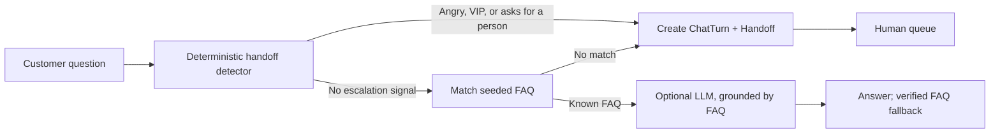

# Handoff Desk

Handoff Desk is a small Harbor Desk support workspace that demonstrates a safer AI support pattern: detect requests that need a person first, answer only known FAQs, and put unresolved requests in a human queue instead of asking a model to guess.

## How it works



The detector runs before FAQ lookup or any LLM call. Angry language, VIP tags, and direct requests for a person are routed deterministically. An unmatched question becomes an `unresolved` handoff. The optional Gemini adapter only receives a matched FAQ answer as grounding, uses a 12-second request timeout, and falls back to that known answer if the provider is unavailable.

## Run locally

Requirements: PHP 8.3+, Composer, Node.js, and npm.

```bash
composer install
copy .env.example .env
php artisan key:generate
php artisan migrate --seed
npm install
npm run build
php artisan serve
```

Open <http://127.0.0.1:8000>. The seeder installs three English FAQs for shipment tracking, returns, and refunds. No account or external service is required. With no `GEMINI_API_KEY`, Laravel binds `FakeLlmClient`; it returns the matched FAQ answer verbatim, so the app works offline and does not invent a reply. To enable optional Gemini replies for matched FAQs, set `GEMINI_API_KEY` (and optionally `GEMINI_MODEL`) in `.env` and restart the app.

## Tests

```bash
php artisan test
```

The Pest feature suite checks that a shipping question is answered from its FAQ, an angry request for a person creates a queued handoff without calling the LLM, an unknown question is escalated rather than answered speculatively, the test container binds the fake LLM client, and a guest can load the chat and submit a successful request.

## Stack

- Laravel 13, PHP 8.3, SQLite
- Vue 3 + Inertia, Tailwind CSS
- `HandoffDetector` and `HandleChatTurn` for deterministic routing
- `LlmClient` interface with `FakeLlmClient` and optional `GeminiLlmClient`

No Redis, real customer data, or payment processing is used.
